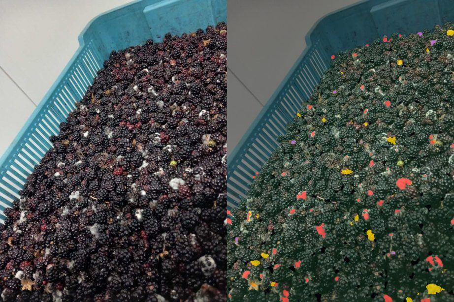

# Оцінка якості: модель і кольоровий метод

> **Головне застереження.** Усі числа нижче отримано на **відкритих даних і синтетичних сценах**, а не на лотках вашого
> підприємства. Вони показують, що модель навчилась і де вона сильніша чи слабша за кольоровий метод, але **не гарантують
> якості на реальних лотках**. Єдине реальне фото лотка (`data/samples`) використано лише для якісного огляду.
> Справжню похибку на виробництві покаже режим «Оцінка сортувальника» (вкладка «Аналітика»).

Модель: **model-v2** (`models/berry-seg.onnx`, float32, 3,6 МБ), MobileNetV3-small + FPN, 25 епох, 34 хв на GTX 1650.
Перевірочна частина (вибір найкращої епохи): mIoU 0,64, recall плісняви 0,87, precision плісняви 0,64.
Відтворити: див. «Повний цикл моделі» в [PROGRESS.md](PROGRESS.md); таблиці нижче — з `runs/v2/eval.md`.

## Як оцінювали

- **Тест — відкладена частина**, яка не бачила навчання: 600 синтетичних лотків (з окремих ягід, яких не було в навчальних сценах),
  327 плиток реальних фото малини (RaspberrySet), 64 фото полуниці на білому тлі, 141 реальне фото полуниці (SmartBerry).
  Розбиття — за вихідними фото, щоб плитки одного фото не потрапили і в навчання, і в тест.
- **Три способи** — так само, як у застосунку: «кольоровий», «гібрид» (кольоровий + модель як перевірка) і «модель».
  Кольоровий метод запускався тим самим JS-кодом, що в браузері (`tools/eval_color.js`).
- **Метрики:** recall / precision / IoU по пікселях для кожного класу; похибка частки — середня |частка програми − частка в розмітці|
  у п.п. від площі ягід (саме ця частка йде у звіт); для плісняви окремо — скільки плям і скільки фото з пліснявою знайдено
  та скільки хибних плям на білих поверхнях (стіна, папір, біле дно лотка, біле тло).
- Пляма плісняви вважається знайденою, якщо програма позначила пліснявою щонайменше 30 % її площі; «хибна пляма» — від 20 px.

## Пліснява (найважливіше)

Синтетичні лотки — єдина тестова група з піксельною розміткою плісняви (1381 пляма на 219 фото):

| Пліснява, синтетичні лотки | Кольоровий | Гібрид | Модель |
|---|---|---|---|
| **Плям знайдено (recall плям)** | 43,8 % | 67,3 % | **89,7 %** |
| **Фото з пліснявою виявлено** | 63,0 % | 86,3 % | **99,1 %** |
| Recall / precision по пікселях | 41,9 % / 43,3 % | 63,8 % / 58,5 % | 94,4 % / 79,4 % |
| Похибка частки плісняви, п.п. | 1,00 | 0,67 | 0,21 |
| Фото без плісняви, де є хибна пляма | 50,6 % | 54,8 % | 33,9 % |
| **Хибна пліснява на білих поверхнях:** частка білих пікселів | 0,25 % | **0,03 %** | 0,07 % |
| **Фото з білими поверхнями, де є хибна пляма на білому** | 21,4 % | **12,6 %** | 23,0 % |

Білі поверхні без ягід (полуниця на білому тлі, 64 фото):

| Хибна пліснява на білому тлі | Кольоровий | Гібрид | Модель |
|---|---|---|---|
| Фото з хибною плямою на білому | 6,2 % | **4,7 %** | 28,1 % |
| Частка білих пікселів, позначених пліснявою | 0,04 % | 0,03 % | 0,20 % |

Реальні фото полуниці (SmartBerry, мітка на все фото — піксельної розмітки немає):

| Клас фото (кількість) | Частка фото, де знайдено пліснява > 1 %: кольоровий / гібрид / модель |
|---|---|
| борошниста роса на плодах — білий грибковий наліт (19) | 0 % / 31,6 % / **89,5 %** |
| гниль плодів (21) | 4,8 % / 28,6 % / 71,4 % |
| стиглі здорові плоди (26) — тут пліснява хибна | 7,7 % / 7,7 % / **0 %** |
| недостиглі здорові (20) — хибна | 0 % / 0 % / 0 % |
| здорове листя (25) — хибна | 4,0 % / 0 % / 0 % |

**Висновки щодо плісняви.**
- Модель знаходить значно більше плісняви, ніж кольоровий метод: на синтетиці 90 % плям проти 44 %, на реальній полуниці
  з борошнистою росою 90 % фото проти 0 %. Кольоровий метод пропускає сірий і тонкий наліт — це очікувано (README, «Відомі обмеження»).
- Але модель сама по собі дає більше хибної плісняви на білому тлі (28 % фото проти 6 %). Тому рекомендований режим — **гібрид**:
  нову плісняву модель додає лише всередині зони ягід, а зняти плісняву кольорового методу може лише там, де впевнено бачить фон.
  Гібрид має найменше хибної плісняви на білих поверхнях і знаходить на 23 п.п. більше плям, ніж кольоровий метод.
- «Фото без плісняви з хибною плямою» високе в усіх способах (34–55 %): у синтетичних сценах багато великих бліків і білих
  папірців серед ягід. За площею це мало (похибка частки 0,2–1 п.п.), але одна хибна пляма на фото трапляється часто.

## Інші категорії

| Синтетичні лотки: IoU (похибка частки, п.п.) | Кольоровий | Гібрид | Модель |
|---|---|---|---|
| якісна | 78,6 % (5,92) | 78,7 % (5,78) | **91,3 % (0,97)** |
| недостигла | 24,1 % (5,16) | 24,2 % (5,15) | **67,3 % (0,66)** |
| пошкоджена / гнила | 0 % (0,31) | 4,7 % (0,30) | 8,8 % (0,28) |
| домішки / стороннє | 12,6 % (1,07) | 12,6 % (1,07) | **64,1 % (0,16)** |

| Реальні фото | Кольоровий | Гібрид | Модель |
|---|---|---|---|
| Малина на кущі (RaspberrySet): недостиглі, IoU | 1,3 % | 1,3 % | **54,1 %** |
| Малина на кущі: стиглі, IoU | 12,6 % | 12,6 % | 28,1 % |
| Полуниця на білому тлі: пошкоджені / гнилі, IoU | 0 % | 50,7 % | **77,0 %** |
| Полуниця на білому тлі: якісні, IoU | 41,8 % | 56,8 % | **79,1 %** |

- Кольоровий метод розрахований на лоток, знятий зверху; фото малини на кущі (листя, небо) для нього невідповідні, тому
  його числа там лише для повноти.
- «Пошкоджені» модель визначає лише для полуниці: тільки для неї були навчальні приклади (гнила полуниця).
  Для ожини, лохини й малини цей клас у браузері вимкнено (DECISIONS.md, D19); на синтетичних лотках через це IoU низький.
- Недостиглі й домішки в гібриді беруться з кольорового методу — модель тут сильніша на відкритих даних, але кольорові пороги
  для недостиглої ожини перевірено на реальному лотку, а модель — ні.

## Зразок `data/samples` (лише якісний огляд)

| Спосіб | Якісні | Недостиглі | Пошкоджені | Пліснява | Домішки |
|---|---|---|---|---|---|
| Кольоровий | 91,6 % | 3,4 % | — | 3,9 % | 1,1 % |
| Гібрид (рекомендований) | 91,4 % | 3,4 % | 0 % | 4,1 % | 1,1 % |
| Модель v2 | 96,7 % | 1,1 % | 0 % | 2,0 % | 0,1 % |
| Модель v1 (для історії) | 50,1 % | 16,4 % | 32,7 % | 0,8 % | 0,1 % |

- Модель v2 правильно виключає стіну й лоток, знаходить більшість білих плям плісняви, не вигадує «пошкоджених».
  Частину сіруватих плям вона пропускає — тому її пліснява (2,0 %) нижча за кольоровий метод; гібрид бере обидва джерела (4,1 %).
- **Модель v1 була непридатна для лотка ожини** ([зображення](docs/model-v1-sample.jpg)): пурпурово-темні стиглі ягоди вона
  вважала «пошкодженими» й «недостиглими». Причина — ягоди ожини з Fruits-360 майже чорні, а реальні мають пурпуровий
  відблиск. У v2 синтетичні ягоди підфарбовано під виміряні кольори реальної ожини (DECISIONS.md, D20).
  **Цю розбіжність знайдено саме на зразку, тож для v2 він уже не є незалежною перевіркою.**

## Вид ягоди (допоміжний вихід)

| Тест | Фото | Точність |
|---|---|---|
| Реальні фото малини | 327 | 100 % |
| Реальна полуниця (SmartBerry) | 141 | 97,2 % |
| Полуниця на білому тлі | 64 | 100 % |
| Синтетичні лотки (4 види) | 600 | 96,5 % |
| Зразок лотка ожини | 1 | ожина, 0,92 |

Реальних фото лохини немає зовсім, реальних лотків — одне фото, тому вид **не перемикається автоматично**: при впевненості ≥ 0,85
і іншому вибраному профілі показується лише зауваження «схоже, на фото інша ягода — перевірте вибір» (DECISIONS.md, D16).

## Квантизація

| Варіант int8 | Розмір | Збіг карти класів з float32 | Збіг плісняви |
|---|---|---|---|
| статична QDQ, MinMax | 1,23 МБ | 75 % | 0,1 % |
| статична QDQ, Percentile 99,99 | 1,23 МБ | 90 % | 7 % |
| лише згортки, Percentile | 1,22 МБ | 89 % | 5 % |
| динамічна, лише ваги | 1,07 МБ | 75 % | 0 % |

(виміряно на v1; на v2 стандартний варіант дав 77 % і 0 %). Квантизація ламає виявлення плісняви й не прискорює роботу на CPU,
тому модель публікується у float32 — 3,6 МБ, у 7 разів менше за ліміт Cloudflare (DECISIONS.md, D18).

## Швидкість

На цьому ноутбуці (Ryzen 7 4800H, браузер, WASM, один потік): завантаження рушія й моделі з локального сервера ~0,9 с,
аналіз одного фото моделлю ~0,4 с (плюс ~0,2 с кольоровий метод). На планшеті очікувано в 2–5 разів повільніше — **не перевірено**.

## Обмеження і що далі

1. **Немає реальних лотків підприємства з розміткою.** Найцінніше, що можна зробити: зібрати 100–300 фото лотків у звичних умовах
   зйомки, для кожного ввести «Оцінку сортувальника» і експортувати ZIP (Історія → Експортувати). Тоді аналітика покаже реальну
   похибку й частку пропущеної плісняви, а фото з виправленою автопідказкою (`data/custom`, `tools/autolabel.js`) підуть у донавчання.
2. Синтетичні сцени оптимістичні: пліснява й бліки домальовані, тож справжні показники на лотках будуть нижчими.
3. «Пошкоджені / роздавлені» для ожини, лохини й малини не визначає ні кольоровий метод, ні модель — немає навчальних прикладів.
4. Лохина перевірена лише на синтетиці (її ягоди з Fruits-360); малина й полуниця — на реальних фото, але не в лотках.
5. Квантизація з дообученням (QAT) могла б зменшити модель утричі без втрати плісняви — варто спробувати, якщо розмір стане проблемою.
